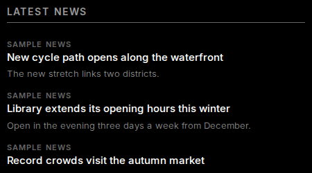

# mirrordash-news

An RSS and Atom news feed reader module for MirrorDash. It fetches headlines and preambles from configurable XML feeds in parallel and displays them in a responsive, snapped HUD layout.

## Features
- **RSS & Atom Support**: Clean XML parsing that supports standard RSS channels and Atom entry namespaces.
- **HTML/XML Tag Stripping**: Automatically cleans up and strips HTML tags, formatting entities, and extra whitespace from titles and preambles.
- **Parallel Fetching**: Loads all configured news sources simultaneously in background threads for rapid refreshes.
- **Looks**: show the headlines as a plain list, slide the next one up, fade through them one at a time, or fade page by page (as many headlines as fit, then the next set). The rotating looks rotate what does not fit in the card; the list fades out at the bottom of the card. Nothing animates continuously, only short transitions between still moments.
- **Auto Speed**: with speed set to Auto, each headline stays long enough to be read, from the words actually visible (4-20 s; a page at most 45 s). Slow, medium and fast use a fixed 12, 8 or 4 s per headline.
- **Glanceable HUD Design**: wraps text cleanly and cuts long summaries after three lines.

## Installation

On the mirror's admin page, open **Modules**: the module is in the list, install it with one click.
Or paste `git+https://github.com/Menturan/mirrordash-news.git` under **Modules → Add modules → Install from a Git URL or folder**.

Developing it: `uv run pytest` runs its tests, and `uvx mirrordash-sdk validate .` checks it.

## Screenshot

## License
[MIT](LICENSE)
